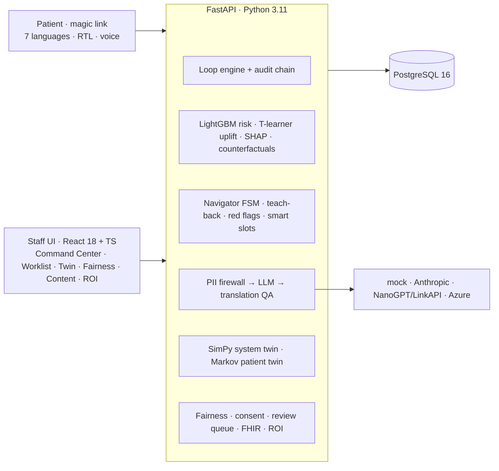

# WASL (وصل) — No abnormal result left behind

AI care navigation that **closes the screening-to-care loop**: every abnormal screening result (HbA1c, FIT, mammogram) is followed until the person is seen — explained in their language, matched to a slot that fits their life, and escalated to a human when needed.

> **WASL does not diagnose.** It explains a screening result, helps the person act on it, and escalates to a human.

**Live:** https://wasl.koushikdeb.com · **Jury login:** `DevTest` / `DevTest11` → press **Judge Mode** (top right) for a guided 3-minute tour with live numbers.
Built for the [Future Health Challenge](https://hack2skill.com/event/futurehealthchallenge/) — track *Population Health: Closing the Screening-to-Care Loop*.

## Quickstart

```bash
cp .env.example .env     # runs with ZERO API keys (offline mock LLM)
make demo                # docker compose: db + backend + frontend, migrate, seed, train, score
open http://localhost:5173
```

Without Docker: `make local-setup`, start PostgreSQL 16, set `DATABASE_URL`, then
`cd backend && alembic upgrade head && python -m app.synth.seed && python -m app.ml.train --seed 42 && uvicorn app.main:app` and `cd frontend && npm run dev`.

Other targets: `make up | down | migrate | seed | train | test | lint | reset-demo`. Demo users (password `demo1234`): `admin@wasl.demo`, `coord@wasl.demo`, `clinician@wasl.demo`, `nav@wasl.demo`.

To use real models set `LLM_PROVIDER=anthropic` (+ `ANTHROPIC_API_KEY`, default model `claude-opus-5-5`) or `LLM_PROVIDER=relay` with OpenAI-compatible relays (`NANOGPT_API_KEY`, `LINKAPI_API_KEY`). Every call passes through the PII firewall and falls back safely on errors and refusals.

## What it does

| # | Module | |
|---|---|---|
| M1 | **Loop Engine** | State machine with SLA timers for every abnormal result; SHA-256 hash-chained, tamper-evident audit trail |
| M2 | **Risk + Uplift** | Calibrated drop-off risk *and* T-learner uplift (who will respond to outreach), SHAP reasons, counterfactual "what would help" |
| M3 | **Multilingual Navigator** | Chat (+ voice) in English, Arabic (RTL), Hindi, Urdu (RTL), Malayalam, Bengali, Tagalog: explains, removes barriers, books, confirms understanding with teach-back |
| M4 | **Care-Pathway Digital Twin** | SimPy simulation to test outreach policies before using them on people; clinician-only Markov patient twin |
| M5 | **Command Center** | KPIs, funnel, SLA breaches, worklist, "Why this patient?" |
| M6 | **Trust & Governance** | Fairness panel, model card, calibration, consent, PII firewall, review queue, audit verification |

Highlights: uplift-based prioritisation under a call budget (with a fairness-constrained option) · back-translation verification with an independent LLM judge and an exact number/test-name check · teach-back · PII firewall · barrier-aware scheduling · counterfactual cards · Policy Twin with sensitivity analysis · hash-chained audit · ROI calculator · Judge Mode · FHIR R4 import/export.

## Architecture



Details: [docs/TECHNICAL.md](docs/TECHNICAL.md) · [docs/MODEL_CARD.md](docs/MODEL_CARD.md) · [docs/DATA_CARD.md](docs/DATA_CARD.md) · [docs/ASSUMPTIONS_AND_LIMITATIONS.md](docs/ASSUMPTIONS_AND_LIMITATIONS.md) · [docs/RESPONSIBLE_AI.md](docs/RESPONSIBLE_AI.md) · [docs/PITCH.md](docs/PITCH.md)

## Results (synthetic data, seed 42)

| | |
|---|---|
| Drop-off risk model | AUROC **0.767**, AUPRC 0.669, Brier 0.190 |
| Uplift ranking (AUUC vs known true effect) | WASL **0.180** > risk 0.156 > random −0.002 |
| Policy Twin, 60-day loop closure | no outreach 59.7 % · SMS 60.2 % · risk-ranked 70.2 % · **WASL uplift 79.5 %** · WASL + fairness 78.5 % |
| Outreach cost per extra closed loop | **AED 95** (WASL) vs AED 178 (risk-ranked) |
| Language fairness | closure gap 40.9 % → 15.1 %; fairness floor cuts the allocation gap 15.8 % → 4.3 % |
| Twin calibration | simulated 59.7 % vs historical 59.0 % no-outreach closure |
| Sensitivity | WASL wins at ×0.5, ×1.0 and ×1.5 outreach effect |
| Tests | 64 backend (Postgres) + 8 frontend; backend coverage 88 % |

## Demo script (Judge Mode, ~3 min)
1. Command Center → 2. Funnel → 3. Worklist Risk → Uplift → 4. Ramesh: Why + What would help → 5. Malayalam chat with teach-back and a Friday-evening slot → 6. Imran: translation QA catches 7.4 → 4.7 → 7. Fatima: red flag → nurse → 8. Policy Twin → 9. Fairness + verify audit chain → 10. ROI + pilot. Full script and judging-criteria mapping: [docs/PITCH.md](docs/PITCH.md).

## Screenshots
See [`../Results/screenshots`](../Results/screenshots) — Command Center, Worklist, Loop detail, Translation QA, Policy Twin, Fairness, Model card, Content Studio, ROI, patient chat (Tagalog, Arabic RTL), dark mode.

## Repository layout
```
backend/   FastAPI app (app/), Alembic migrations, pytest suite (tests/), fixtures (templates, translations, red flags, FHIR)
frontend/  React + Vite + TS app (src/), Vitest (tests/)
docs/      technical design, model & data cards, assumptions, responsible AI, pitch
deploy/    host deploy script, uvicorn run/stop/watchdog, Caddy site block
```

All data is synthetic. Every clinical number marked ILLUSTRATIVE is a configurable assumption (see [docs/ASSUMPTIONS_AND_LIMITATIONS.md](docs/ASSUMPTIONS_AND_LIMITATIONS.md)).
