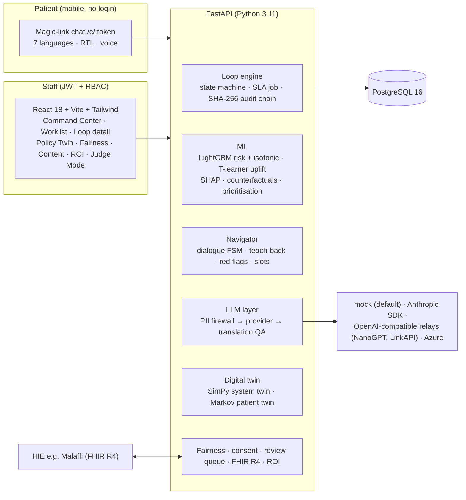
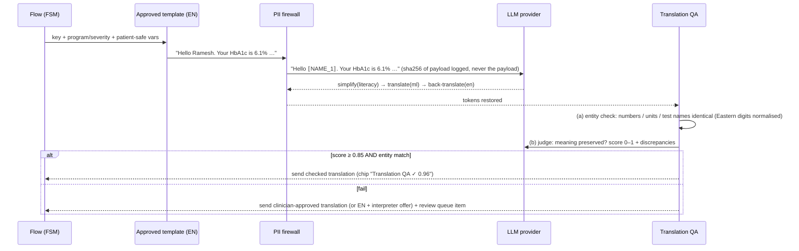
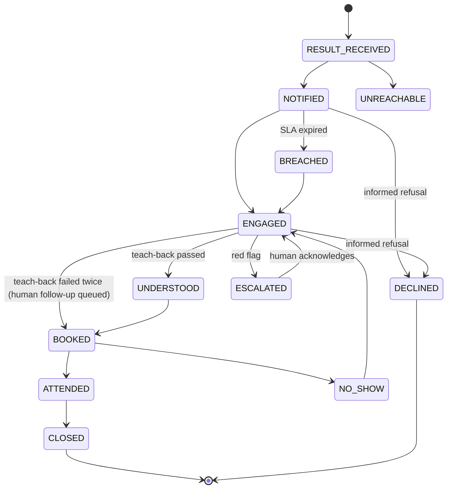

# WASL — Technical design

> **WASL does not diagnose.** It explains a screening result, helps the person act on it, and escalates to a human.

## 1. Architecture

| Layer | Choice | Why |
|---|---|---|
| API | FastAPI, Pydantic v2, SQLAlchemy 2.0 typed ORM, Alembic | Typed end-to-end, OpenAPI for the typed TS client |
| DB | PostgreSQL 16 (JSONB, TEXT[]) | Production-shaped; tests also run on it (SQLite fallback via portable types) |
| ML | LightGBM, scikit-learn isotonic, SHAP TreeExplainer | Fast, explainable tree models on tabular social/clinical features |
| Twin | SimPy discrete-event simulation | Resources (navigators, clinics) and queues are first-class |
| Frontend | React 18 + TS strict + Tailwind + TanStack Query + Recharts + react-i18next + Zustand | Small, fast, accessible; RTL via `dir` |
| LLM | Provider interface: mock / Anthropic / OpenAI-compatible relay / Azure | Runs with zero keys; real models are opt-in |

## 2. Modules

| Module | Code | What it does |
|---|---|---|
| M1 Loop Engine | `backend/app/loop_engine/` | Validated transitions (`state_machine.py`), SLA breach job (`sla.py`, APScheduler, simulated clock), hash chain (`audit.py`) with per-loop and global chains, advisory-locked so concurrent writers never share a sequence number |
| M2 Risk + Uplift | `backend/app/ml/` | Features, calibrated risk, T-learner uplift, hand-written Qini/AUUC, SHAP reasons, counterfactual search over actionable levers, budgeted prioritisation with fairness floors |
| M3 Navigator | `backend/app/navigator/`, `backend/app/llm/` | Deterministic dialogue FSM; LLM only for understanding free text and phrasing approved templates |
| M4 Digital Twin | `backend/app/twin/` | SimPy care-pathway twin (5 policies, sensitivity, calibration) + Markov patient twin (clinician-only) |
| M5 Command Center | `frontend/src/pages/` | KPIs, funnel from the audit log, worklist, loop detail, live escalations |
| M6 Trust & Governance | `backend/app/fairness/`, `backend/app/api/governance.py` | Fairness metrics, model card, calibration, audit verify/export, consent, review queue |

## 3. One outgoing message, end to end

* Refusals / `max_tokens` → approved text is sent and an `llm_refusal` escalation is opened.
* Transport errors → the task falls back to deterministic mock behaviour (logged).
* Passing results are cached (`llm_cache`), keyed by template version, language, literacy and rendered text, so demo personas are instant; personas are pre-warmed after every reset when a real LLM is configured.
* Model routing on the relay provider: chat understanding, simplification, back-translation and the judge use a fast model (LinkAPI Gemini Flash); translation uses Claude (NanoGPT). The judge is therefore a *different model family* from the translator.

## 4. Care-loop state machine

Design decision: the navigator runs **teach-back before confirming the booking**, so the loop moves ENGAGED → UNDERSTOOD → BOOKED in order. Care is never blocked on comprehension: after two failed attempts a human is queued and booking proceeds.

## 5. Digital twins

**System twin (`twin/system_twin.py`).** 5,000 synthetic abnormal results arrive over 180 days. Each day a policy chooses whom to contact under the same daily budget; tailored contacts consume navigator time (`simpy.Resource`, 15 min/call); people who return queue for their nearest clinic (`simpy.Resource` per clinic). Whether and when someone returns comes from the hidden ground-truth behaviour model plus the effect of the outreach package used.

* **Paired comparison with common random numbers** (borrowed from the NemoTwins/Pratifalan particle twins): every policy sees the same people and the same uniforms, so differences come from the policy, not sampling noise.
* **Policies rank with the trained models**, outcomes come from ground truth — exactly as in reality.
* **Calibration**: the no-outreach closure rate is compared with the synthetic historical no-outreach return rate (59.7 % vs 59.0 % at seed 42).
* **Sensitivity**: every policy re-run with the true outreach effect ×0.5 / ×1.0 / ×1.5 → robustness badge.
* **Fairness**: closure gap (best − worst language group) *and* allocation gap (largest shortfall of budget share below need share). Fairness floors use carry-over quotas so small groups are not rounded to zero on small daily budgets.
* 5 policies × 5,000 patients run in ≈ 2 s.

**Patient twin (`twin/patient_twin.py`).** Per-program Markov chain (yearly rates → monthly), untreated rates during a follow-up delay and in-care rates afterwards; 400 parameter draws (±35 %) give the 90 % band. ILLUSTRATIVE, clinician/coordinator only (RBAC-enforced, navigator → 403).

## 6. Security & privacy

* JWT (HS256) + RBAC matrix in `security.CAPABILITIES`, tested in `tests/test_phase6_governance.py`.
* Identity lives in `patient_identity`, separate from pseudonymous clinical data; role-masked serialisers (admin full · coordinator/clinician masked · navigator first name only).
* Magic links: random 192-bit token, only its SHA-256 is stored, 14-day expiry, scoped to one loop.
* PII firewall on every LLM call; unit test proves no identity string reaches the provider.

## 7. Testing

`make test` → 64 backend tests (pytest, Postgres) + Vitest. Coverage: total 88 %; `loop_engine`, `ml`, `navigator`, `llm`, `twin`, `fairness` all ≥ 70 %. Acceptance checks of every build phase are encoded as tests (`tests/test_phase*.py`).
