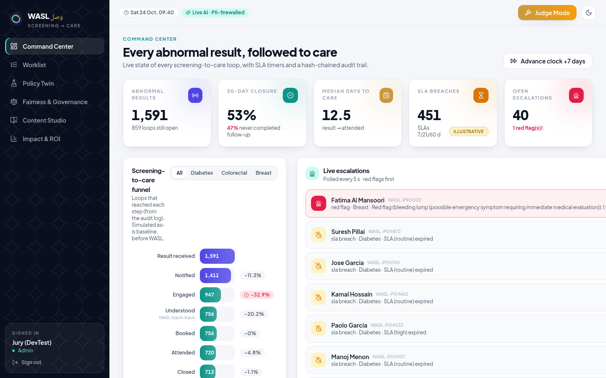
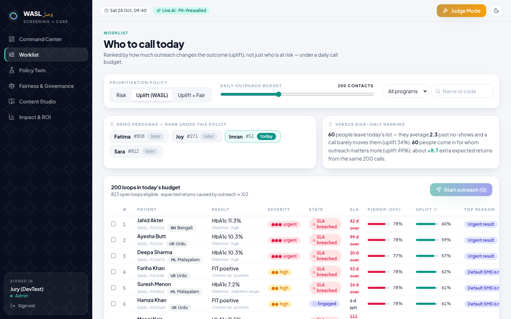
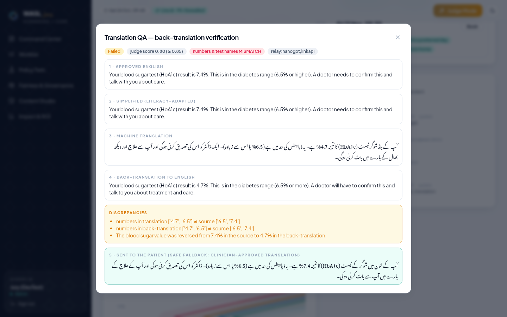
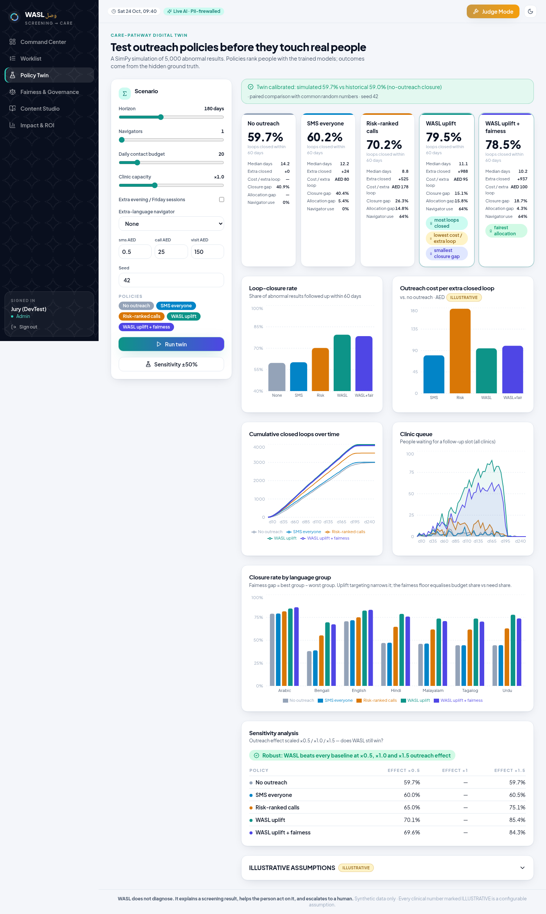

# WASL (وصل) — No abnormal result left behind

**Future Health Challenge (Abu Dhabi) · Population Health — Closing the Screening-to-Care Loop**

Many people who get an abnormal screening result — a high HbA1c, a positive stool test, a suspicious mammogram — never complete the follow-up. The result wasn't explained in their language, the appointment clashed with their shift, or they feared the cost. WASL ("connection" in Arabic) is an AI care-navigation platform that follows every abnormal result until the person is seen.

> **WASL does not diagnose.** It explains a screening result, helps the person act on it, and escalates to a human.

### Try it
**https://wasl.koushikdeb.com** — jury login **User `DevTest` · Password `DevTest11`**, then press **Judge Mode** for a 3-minute guided tour. Each step runs live: a Malayalam conversation, a red-flag escalation, a 5-policy digital-twin run.

| | |
|---|---|
|  |  |
|  |  |

### What makes it different
* **Uplift, not just risk.** A T-learner predicts *who outreach will actually help*, and ranks the daily call list by that, with an optional fairness floor per language group. Under the same 200 calls, 60 people who rarely respond are swapped for 60 whose outcome a call changes.
* **The AI is checked before it speaks.** Every translated message is back-translated and checked. An independent LLM judge reviews meaning, and an exact check compares numbers and test names. If either fails, the patient gets the clinician-approved translation and a human reviews it.
* **Teach-back, red flags, consent.** The person explains the result in their own words before booking. Emergencies reach a nurse instantly (UAE 999 advice) and pause the AI. Revoking consent stops outreach.
* **PII firewall.** The LLM never sees a name, phone number or Emirates ID.
* **Care-pathway digital twin.** A SimPy simulation of 5,000 people compares 5 policies on common random numbers before any real person is contacted. The patient twin projects the cost of delay (clinicians only).
* **Tamper-evident.** Every loop event is SHA-256 hash-chained; "Verify chain" proves nothing was altered.
* **7 languages** (Arabic and Urdu right-to-left), voice input and read-aloud, FHIR R4 import/export, ROI calculator.

### Results on synthetic data (seed 42)
* Policy Twin: 60-day loop closure **59.7 % → 79.5 %**.
* WASL costs **AED 95** per extra closed loop, vs AED 178 for risk-ranked calls.
* The closure gap between language groups narrows from **40.9 % to 15.1 %**.
* Drop-off risk AUROC **0.767**.
* Uplift ranking beats risk ranking against the known true effect: AUUC 0.180 vs 0.156.
* 64 backend + 8 frontend tests; backend coverage 88 %.

### Repository
```
Codes/     the application — backend (FastAPI · PostgreSQL · LightGBM · SimPy), frontend (React · TypeScript), docs, deploy
Results/   screenshots of the running system
```
Start with [Codes/README.md](Codes/README.md) (quickstart: `cp .env.example .env && make demo`, no API keys needed) and [Codes/docs/PITCH.md](Codes/docs/PITCH.md) (demo script + judging-criteria mapping).

All patient data is synthetic. Clinical numbers marked ILLUSTRATIVE are configurable assumptions, not estimates. Translations are demo fixtures and are not clinically validated.
